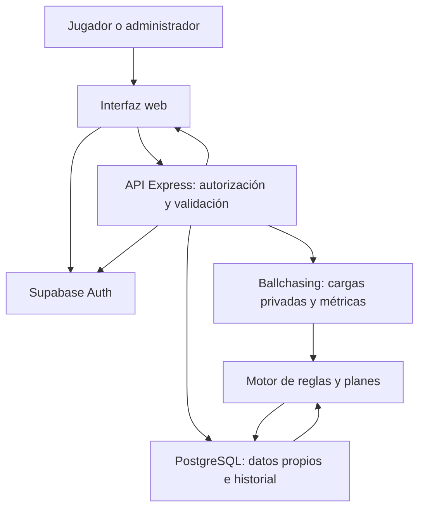
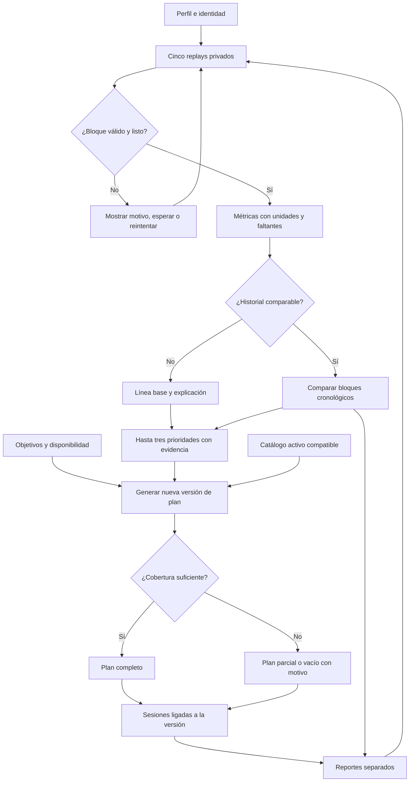

# Arquitectura y diagramas

## Arquitectura del MVP

Express valida identidad y permisos. El motor usa métricas con trazabilidad y reglas versionadas; no usa objetivos para cambiar el diagnóstico. La clave Ballchasing permanece en el servidor. Los datos se asocian al propietario y al bloque/plan correctos.

## Ciclo adaptativo y estados

La primera medición establece línea base. Una sesión autorreportada evidencia entrenamiento; los cambios de rendimiento se calculan con replays comparables. Modificar meta, perfil o catálogo exige una nueva versión de plan. Las vistas de historial conservan evidencia anterior.

## Referencias existentes
[Modelo entidad-relación organizado](https://miro.com/app/board/uXjVEcCTPrc=/)

[System Map](https://miro.com/app/board/uXjVHnaZoh0=/)

[Plan de desarrollo en Miro](https://miro.com/app/board/uXjVEcA_AAE=/)

## Revisión de datos en S1
Auditar sesiones, historial de rango, evidencia de diagnóstico y snapshots completos; el esquema actual de ocho tablas es una base, no una confirmación de implementación. Esta release conserva intactos los tableros anteriores.

## Responsabilidades y función completa A19
Luis diseña e implementa las interfaces definitivas del jugador; Tadeo mantiene servidor/Ballchasing; David datos/auth y la implementación administrativa; Roberto métricas/reglas/planes. A19 es compartida: Luis construye la interfaz de Análisis y Roberto consulta bloques propios, implementa el endpoint y conecta su respuesta a la pantalla JavaScript/Chart.js. Ambos comprueban el recorrido; el diseño provisional del cascarón PROGSA se sustituye por el de Luis. Tadeo coordina A25. [Reparto de frontend](frontend-luis.md) · [Empieza aquí](empieza-aqui.md).

## Base lista para construir
[Contrato](contratos-api.md), [diccionario](diccionario-datos.md) y [flujo](flujo-pantallas.md) preparados. El ERD histórico sigue como referencia; David valida propuesta en A07 antes de aplicar migraciones. A01 revisa la base y no exige cerrar por adelantado las comprobaciones de A05/A07/A08.
