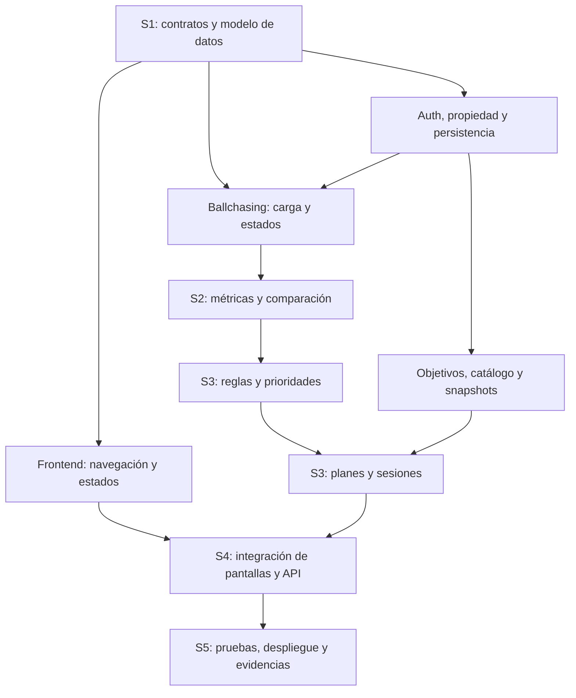

# Calendario y dependencias

## Calendario interno
| Semana | Periodo | Corte interno | Resultado integrado |
| --- | --- | --- | --- |
| S1 · Base y viabilidad | 2026-10-12 a 2026-10-18 | 2026-10-18 | Contrato, esquema revisado, navegación y prueba real de Ballchasing. |
| S2 · Primer bloque real | 2026-10-19 a 2026-10-25 | 2026-10-25 | Jugador autenticado carga cinco replays privados y obtiene métricas válidas. |
| S3 · Diagnóstico y plan | 2026-10-26 a 2026-11-01 | 2026-11-01 | Diagnóstico explicable, plan versionado, objetivos y registro de sesiones. |
| S4 · Integración completa | 2026-11-02 a 2026-11-08 | 2026-11-06 | RF01–RF12 conectados, administración y segundo bloque comparable. |
| S5 · Entrega preparada | 2026-11-09 a 2026-11-15 | 2026-11-13 | Pruebas cerradas, despliegue reproducible, documentos y ensayo de demostración. |
| S6 · Reserva de entrega | 2026-11-16 a 2026-11-22 | 2026-11-20 | Correcciones puntuales y entrega en la fecha que confirmen los profesores. |

## Hitos
2026-11-06: RF obligatorios integrados. 2026-11-13: pruebas, documentos y demostración preparados. Del 2026-11-16 al 2026-11-20: ventana estimada de entrega; pendiente de confirmación. El 21–22 queda como contingencia si la fecha real lo permite.

## Dependencias de desarrollo

Los IDs de dependencia del backlog señalan qué debe existir primero. Las fechas intermedias son entregas de interfaz funcional, no solo un boceto. Un cambio al contrato se comunica a sus consumidores antes de modificarlo.

Calendario oficial: [FIME agosto–diciembre 2026](https://www.fime.uanl.mx/wp-content/uploads/2026/07/calendario-agosto-diciembre2026.pdf). Últimas clases/laboratorios: 20 de noviembre; ordinarios: 23 de noviembre–3 de diciembre. La ventana 16–20 de noviembre es una estimación basada en entregar una semana antes de exámenes, **no una fecha confirmada por profesores**.

## Entregas entre módulos y aprendizaje
- S1: A01 acuerdo de datos, A03 flujo de Luis, A05 viabilidad de Tadeo y A07 modelo de David al 14 de octubre.
- S2: A14/A15 entregan extracción/consultas al 21; A13 carga al 22; A09/A10 completan métricas/comparación al cierre.
- S3: A17 prioridades y A23/A24 catálogo/versiones al 28; A19 completa datos → servidor → pantalla y A18 genera planes al cierre.
- S4: Tadeo coordina A25, cada dueño corrige su módulo; Roberto revisa el recorrido y A26.

A19 reutiliza A04/A06/A09/A10/A15/A17. No exige recrear el servidor, diseño o base de datos. Luis revisa la pantalla mediante el PR; las explicaciones y revisiones se pueden realizar por escrito.
