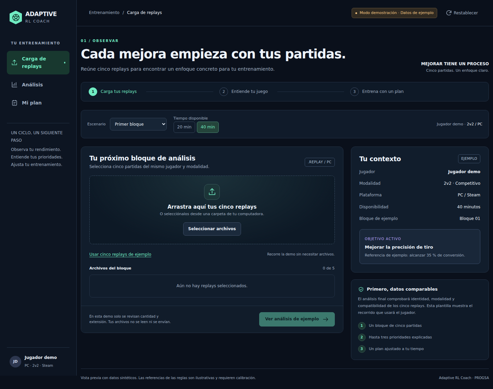
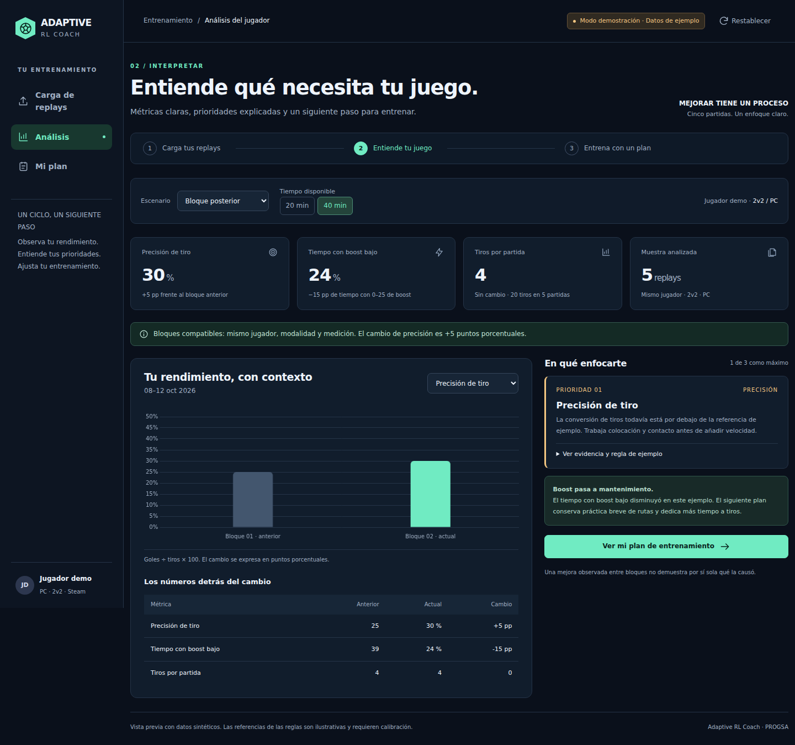
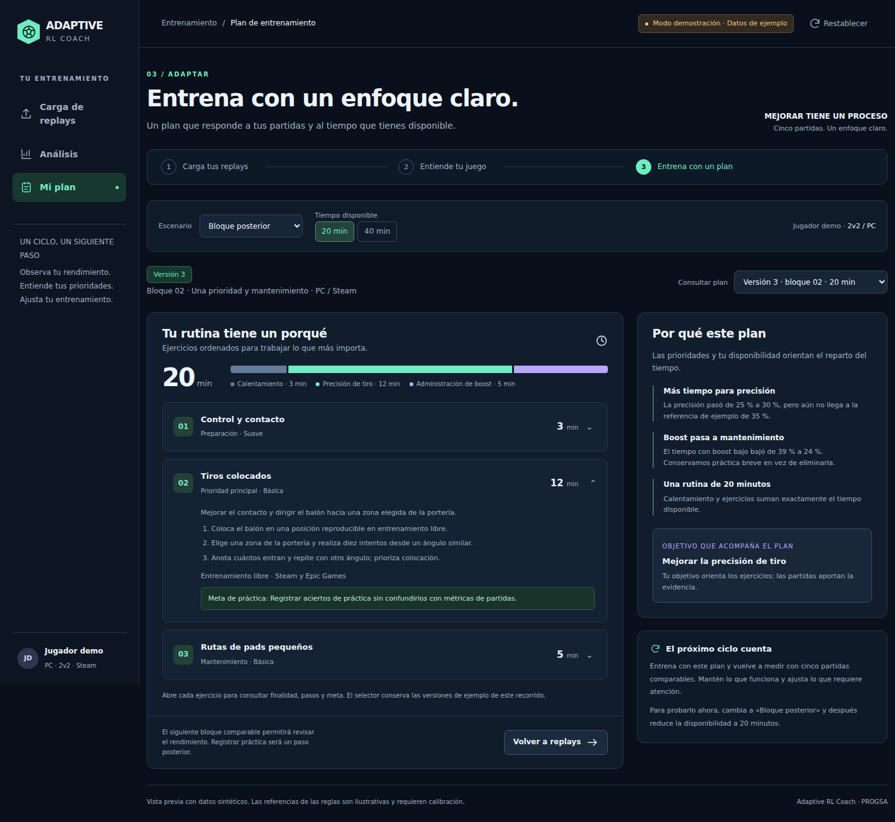

# Vistas oficiales del jugador

Las vistas oficiales de Luis están en `public/sitio/html`: **Replays → Análisis → Plan**. Comparten los servicios de datos sintéticos para conservar el recorrido de demostración mientras se conectan los endpoints definitivos. [Reparto y entregas de frontend](frontend-luis.md).

## Abrir la demostración

Para usar la carga y el API local:

1. Ejecutar `npm ci` y `npm start` desde la raíz.
2. Abrir `http://127.0.0.1:3000/`; la entrada lleva a Replays.
3. Seleccionar exactamente cinco archivos `.replay` distintos y pulsar **Procesar bloque**.
4. Abrir Análisis y Plan para consultar la demostración sintética.

También se puede servir localmente desde la raíz del repositorio:

```bash
python -m http.server 8000 --directory public
```

En Windows, si el comando disponible es `py`, usar `py -m http.server 8000 --directory public`. Abrir `http://localhost:8000/sitio/html/analisis.html?scenario=initial&minutes=40`. Para detener el servidor, Ctrl+C.

## Guion de presentación de 3–4 minutos

| Paso | Qué hacer | Qué explicar |
| --- | --- | --- |
| 1 · Entrada | Abrir Replays y seleccionar cinco archivos `.replay`. | El sistema valida cantidad, extensión y duplicados antes de enviar el bloque. |
| 2 · Línea base | Abrir Análisis con el primer bloque. | El primer bloque establece el punto de partida: no muestra una comparación inexistente. Aparecen boost y precisión como prioridades. |
| 3 · Primera respuesta | Abrir Plan. | El plan distribuye 40 minutos entre calentamiento, rutas de boost y tiros; cada ejercicio tiene finalidad e instrucciones. |
| 4 · Retroalimentación | Cambiar Escenario a «Bloque posterior» y abrir Análisis. | La precisión pasa de 25 % a 30 %: son +5 puntos porcentuales. El tiempo con boost bajo pasa de 39 % a 24 %. Se conservan contexto y modalidad. |
| 5 · Adaptación | Abrir Plan. | La referencia ilustrativa deja boost en mantenimiento y concentra más tiempo en precisión. Se explica qué cambió. |
| 6 · Contexto | Elegir 20 minutos. Consultar después una versión anterior con el selector. | La rutina se reorganiza para caber en 20 minutos. La versión de 40 minutos conserva su contenido. |

Cerrar explicando: «Esta es la interfaz y una demostración con datos de ejemplo. En la aplicación final Ballchasing aportará las estadísticas y las reglas deberán validarse. Las sesiones registran entrenamiento; los nuevos bloques permiten medir el rendimiento».

Si quieren repetir el recorrido, **Restablecer** vuelve a primer bloque, 40 minutos y una única versión de ejemplo.

## Qué funciona en esta entrega

- Navegación entre las tres vistas con escenario, minutos y versiones conservados en la URL. Funciona incluso con apertura directa de archivos.
- Selector local de archivos y arrastrar/soltar en Replays: valida exactamente cinco, extensión `.replay` y duplicados; permite quitar un archivo.
- Envío del bloque válido a `POST /api/v1/blocks`, con estado inicial `pending`.
- Dos conjuntos sintéticos de cinco partidas, cálculos de precisión por totales y media de boost ponderada por duración.
- Línea base frente a comparación posterior, gráfico con selector de métrica, tabla accesible y prioridades con evidencia desplegable.
- Planes de 20/40 minutos, instrucciones desplegables y consulta de versiones de ejemplo anteriores durante el recorrido.
- Estilos adaptables a móvil, navegación por teclado, etiquetas y mensajes que no dependen solo del color.
- Bootstrap, jQuery y Chart.js guardados localmente con versiones fijadas y sus licencias.

## Qué permanece para la implementación

La selección local no lee ni analiza el contenido de los replays, no comprueba identidad real y no los envía. La muestra no llama a Ballchasing, no autentica ni guarda en base de datos. Las versiones se reconstruyen con los datos de ejemplo y la URL, no son historial persistido del usuario. Una URL directa sin el contexto del recorrido abre su escenario inicial; un enlace copiado con los parámetros conserva ese recorrido.

Las dos reglas son exclusivamente ilustrativas: `boost_low_pct > 30` y `shooting_pct < 35`, versión `demo.rules.v1`. **No se presentan como umbrales calibrados ni como la configuración verificada del prototipo Python.** Su finalidad es mostrar cómo una condición cambia una recomendación. Los números son sintéticos y no describen a Roberto ni a otro jugador real.

La mejora entre bloques no demuestra que el ejercicio la causó. Los porcentajes de boost son una señal para orientar la práctica, no una detección automática de errores de rotación o intención.

## Cómo encaja con el reparto

| Trabajo definitivo | Referencia funcional de esta demostración sintética | Entrega acordada |
| --- | --- | --- |
| A03/A04 · Luis | Esta demo fue un avance separado de sus vistas públicas. | Sus cuatro vistas ya están integradas y ambas issues cerradas; el resto del frontend continúa. |
| A11 · Luis | Recorrido ilustrativo de selección de replays. | Diseñar/construir Carga definitiva y conectarla con API y estados; historial continúa en A28. |
| A19 · Roberto y Luis | Ejemplo de información de métricas/comparación. | Luis construye la interfaz de Análisis; Roberto consulta, calcula, expone el endpoint y conecta datos → API → pantalla. |
| A27 · Luis | Ejemplo de información de planes/versiones. | Diseñar/construir Plan definitivo y conectar propuesta calculada y versiones persistidas; interfaz de Sesiones en A28. |

Tadeo mantiene servidor/Ballchasing e integración; David datos/Auth/historial. Esta muestra es avance parcial y no cierra automáticamente A04/A11/A19/A27, no reasigna responsables ni cambia sus fechas. PR relacionado con #4, #11, #19 y #27.

## Archivos y puntos de conexión

| Archivo | Responsabilidad |
| --- | --- |
| `public/sitio/html/replays.html` | Carga e historial oficial de bloques. |
| `public/sitio/html/analisis.html` | Métricas, gráfica, tabla y prioridades oficiales. |
| `public/sitio/html/plan.html` | Plan, ejercicios, motivos y versiones oficiales. |
| `public/sitio/css/index.css` | Diseño y componentes compartidos del sitio. |
| `public/js/demo-data.js` | Datos sintéticos, normalización y reglas ilustrativas como funciones separadas. |
| `public/js/demo-service.js` | Origen de datos de ejemplo; punto para conectar el servicio real después. |
| `public/js/app.js` | Eventos de interfaz, navegación, presentación y estado del recorrido. |
| `public/vendor/README.md` | Versiones, origen, integridad y licencias de dependencias. |

Las funciones `loadAnalysis` y `loadPlan` devuelven un sobre `{ data, meta }` siguiendo la convención del contrato inicial. Las vistas oficiales muestran esta presentación sintética mientras A19 mapea las respuestas reales, gestiona espera/error y prueba permisos. Los controladores no contienen claves ni llamadas al proveedor; las reglas de demo no sustituyen el motor definitivo.

Referencias internas: [contrato inicial](contratos-api.md), [flujo de pantallas](flujo-pantallas.md), [base técnica](base-tecnica.md). Referencias académicas: Fase 1, secciones 6.6/6.7/6.9; Sprint 1, ciclo de comparación y ajuste del entrenamiento.

## Comprobaciones de desarrollo

El uso de la demo no necesita Node. Para repetir los controles de navegador, con Playwright instalado en un entorno de desarrollo:

```bash
python -m http.server 4173 --directory public
node tests/demo-smoke.cjs
```

El script comprueba validación de archivos, navegación, comparación, reparto de minutos, versiones anteriores, apertura directa sin red, ausencia de peticiones externas y anchos de 390 px. Guarda capturas en un directorio temporal o en `DEMO_QA_DIR`. Las pruebas de permisos y API real corresponden a las tareas de implementación.


## Capturas de referencia

### Carga



### Análisis de un bloque posterior



### Plan adaptado a 20 minutos


