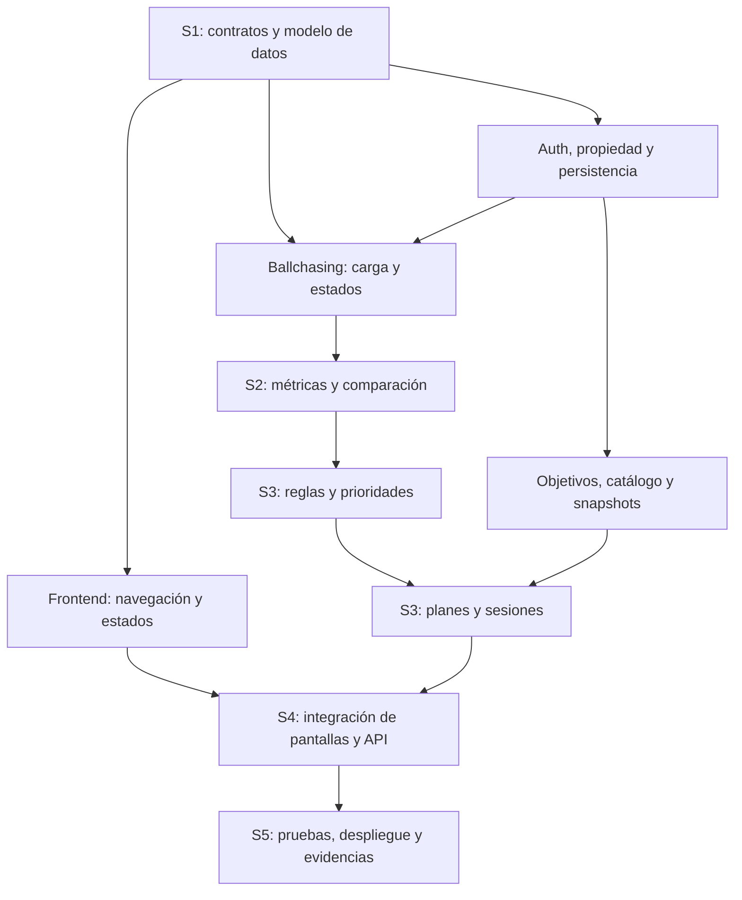

# Plan sustituido · octubre de 2026

Referencia histórica, reemplazada con autorización de Roberto el 1 de noviembre. No describe avance ni fechas vigentes. Versión anterior completa en el commit 31a1951835078dfe16888d4571bf1c5025ac0f9a.

# Calendario y dependencias · referencia

Las fechas siguientes proceden del plan inicial y son metas internas, no compromisos académicos confirmados ni evidencia de avance. El trabajo inmediato se consulta en [la guía breve](../empieza-aqui.md) y en las issues. Preferencia vigente: avance intermedio el jueves.

**Project:** once campos `Target date` quedaron pendientes de sincronización en la revisión anterior. No usar el Roadmap como fecha definitiva; esta simplificación no declara esa sincronización realizada.

## Calendario interno
| Semana | Periodo | Corte interno | Resultado integrado |
| --- | --- | --- | --- |
| S1 · Base y viabilidad | 2026-10-12 a 2026-10-18 | 2026-10-18 | Contrato, esquema revisado, navegación y prueba real de Ballchasing. |
| S2 · Primer bloque real | 2026-10-19 a 2026-10-25 | 2026-10-25 | Jugador autenticado carga cinco replays privados y obtiene métricas válidas. |
| S3 · Diagnóstico y plan | 2026-10-26 a 2026-11-01 | 2026-11-01 | Diagnóstico explicable, plan versionado, objetivos y registro de sesiones. |
| S4 · Integración completa | 2026-11-02 a 2026-11-08 | 2026-11-06 | RF01–RF12 conectados, administración y segundo bloque comparable. |
| S5 · Entrega preparada | 2026-11-09 a 2026-11-15 | 2026-11-13 | Pruebas cerradas, despliegue reproducible, documentos y ensayo de demostración. |
| S6 · Reserva de entrega | 2026-11-16 a 2026-11-22 | 2026-11-20 | Correcciones puntuales y entrega en la fecha que confirmen los profesores. |

## Hitos
2026-11-06: RF obligatorios integrados. 2026-11-13: pruebas, documentos y demostración preparados. Del 2026-11-16 al 2026-11-20: ventana estimada de entrega; pendiente de confirmación. El 21–22 queda como contingencia si la fecha real lo permite.

## Dependencias de desarrollo

Los IDs de dependencia señalan qué debe estar conectado para cerrar. La base/fixtures permiten iniciar en paralelo; las entregas intermedias de jueves aportan contratos verificados o interfaces según la tarea. Un cambio al contrato se comunica a sus consumidores antes de modificarlo.

Calendario oficial: [FIME agosto–diciembre 2026](https://www.fime.uanl.mx/wp-content/uploads/2026/07/calendario-agosto-diciembre2026.pdf). Últimas clases/laboratorios: 20 de noviembre; ordinarios: 23 de noviembre–3 de diciembre. La ventana 16–20 de noviembre es una estimación basada en entregar una semana antes de exámenes, **no una fecha confirmada por profesores**.

## Entregas entre módulos y aprendizaje
- S1, jueves 15 de octubre: A01 revisión de base, A03 flujo validado, A05 prueba real de Ballchasing y A07 modelo validado.
- S2, jueves 22 de octubre: A14 validación/extracción, A15 persistencia y A13 carga/estados. Preparar A13 con fixtures desde el lunes y conectar al recibir A14/A15; comunicar cualquier bloqueo de integración. A09/A10 completan métricas/comparación al domingo 25.
- S3, jueves 29 de octubre: A17 prioridades, A23 catálogo y A24 versiones; A18/A19/A21/A22 conectan datos reales para domingo 1 de noviembre.
- S4, jueves 5 de noviembre: A29 usuarios y A31 historial; las pantallas consumidoras pueden prepararse antes con ejemplos. Corte integrado viernes 6; Tadeo coordina A25.

A19 reutiliza A04/A06/A09/A10/A15/A17. Luis revisa la pantalla. Explicaciones y revisiones por escrito; no se exige trabajo acompañado. Los domingos y cortes viernes no se desplazan con este cambio; son metas internas, no fechas confirmadas por profesores.

## Cambios de fechas autorizados el 13 de octubre
| Tarea | Antes | Ahora (jueves) |
| --- | --- | --- |
| A01 | 2026-10-14 | 2026-10-15 |
| A03 | 2026-10-14 | 2026-10-15 |
| A05 | 2026-10-14 | 2026-10-15 |
| A07 | 2026-10-14 | 2026-10-15 |
| A14 | 2026-10-21 | 2026-10-22 |
| A15 | 2026-10-21 | 2026-10-22 |
| A17 | 2026-10-28 | 2026-10-29 |
| A23 | 2026-10-28 | 2026-10-29 |
| A24 | 2026-10-28 | 2026-10-29 |
| A29 | 2026-11-04 | 2026-11-05 |
| A31 | 2026-11-04 | 2026-11-05 |
